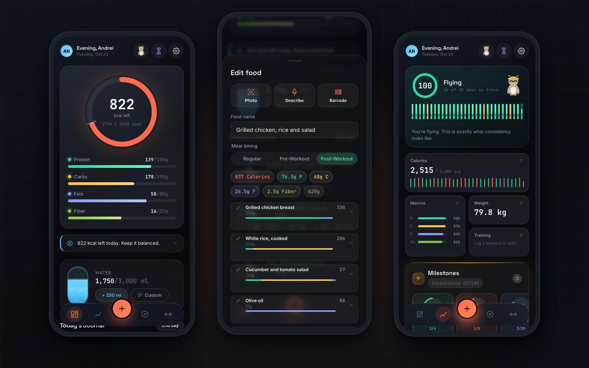
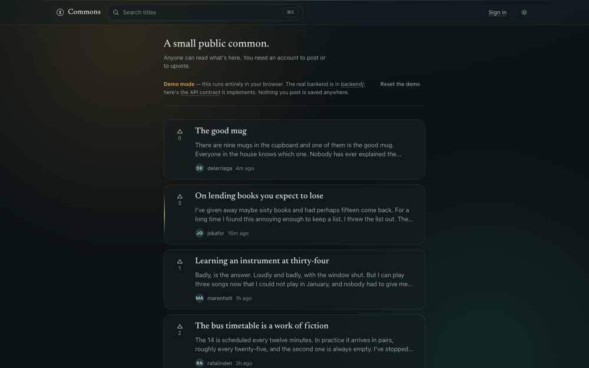

<picture>
  <source media="(prefers-color-scheme: dark)" srcset="assets/header-dark.svg" />
  <source media="(prefers-color-scheme: light)" srcset="assets/header-light.svg" />
  
</picture>

 

  

 

I'm Andrei, a computer science student in Constanța, Romania. I build web apps on my own,
from the database to the screen, and then I keep them running. That second part taught me
more than the first: migrations, CI, deploys, and what a service should do when an API it
depends on starts timing out at three in the morning.

I like to measure before I decide. My bigger projects keep a written log of their design
decisions and what each one cost. When I give a number on this page, I measured it, and
you can check it in the repository.

**Looking for** a junior full-stack or backend role, or a software engineering internship.

 

## Featured projects

### 📷 IoT Vision Hub

**A home security hub for the cameras you already own.**

It started as a 160-line OpenCV script that emailed me a photo whenever my webcam saw
movement. It mostly worked. One person walking past sent five emails, and every sunset
counted as movement.

The rebuild takes any number of webcams, RTSP cameras or video files. A YOLOX model running
on the hub itself decides whether the motion is a person, a tracker follows them across the
frame, and if someone stands at your door longer than you've allowed, your phone gets a
notification with the clip. Nothing leaves your network unless you want alerts outside it.

- A person check takes about 0.3 s of a CPU core, which would freeze a live camera. So all
  cameras share one background thread for the model, and a tracker that costs under 10 µs a
  frame covers the time in between.
- Alerts are saved to the database before they're sent and retried across restarts: web push,
  email, Telegram or a signed webhook. A covered or turned-away camera raises its own alert.
- The live demo is the real dashboard. On every push, CI runs four real video clips through
  the actual detection pipeline, records what it found, and the page replays that recording
  in your browser.

FastAPI · PostgreSQL · OpenCV · ONNX Runtime · vanilla JS PWA · one Docker image for amd64 and arm64, Raspberry Pi included · 1,000+ tests at 99% coverage

**[Live demo →](https://andrewtechtips.github.io/iot-vision-hub/)** &nbsp;·&nbsp; **[Code →](https://github.com/AndrewTechTips/iot-vision-hub)**

 

### 🥗 Iron Log

**Take a photo of your plate, get the calories and macros for each ingredient.**

Most calorie trackers make you search a database for every item on the plate, which is why
people give up after a week. Iron Log sends the photo to one model call that names each
ingredient, estimates its weight and returns calories, protein, carbs, fat, fibre, sugar and
sodium. Plain arithmetic then checks the answer for numbers no real food could have.

The most useful thing I did here was switch off a feature I had already built. Every
ingredient used to be matched against USDA and Open Food Facts before I trusted the model,
which sounds like the safe choice. In practice a text match priced Romanian *telemea* cheese
off a USDA entry called "Bread, cheese". On 20 real meals the median calorie error was 16.5%
with the lookup and 2.6% without it, so the lookup now sits behind a flag.

I also found that 43% of first attempts were being cut off and billed anyway, because the
model's hidden reasoning shares a token budget with the answer. Sizing that budget from 33
recorded calls took cut-offs to zero and the cost per scan from $0.0144 to $0.0088.

FastAPI on a VPS behind Traefik · Supabase Postgres · installable PWA with zero runtime JS dependencies · ~700 tests · deploys over SSH when CI is green

**[Live app →](https://andrewtechtips.github.io/calorie-tracker/)** &nbsp;·&nbsp; **[Code →](https://github.com/AndrewTechTips/calorie-tracker)**

 

### 💬 Commons

**A small public social feed, with a demo that can't drift from the real API.**

Anyone can read the feed, and an account lets you post, comment and upvote. The backend is
FastAPI with PostgreSQL 17. The frontend is plain JavaScript with no framework and no build
step, type-checked anyway through JSDoc.

GitHub Pages can't run FastAPI, and I didn't want the demo link to open on "can't reach the
server". So the published build answers its own API calls inside the browser, and the same
338 Playwright tests run against that version and against the real backend.

Some things I got wrong the first time:

- The feed sent unpublished drafts to everyone and the UI just labelled them "Draft". Now the
  query only returns posts that are published or yours, and someone else's draft is a `404`,
  since a `403` would confirm it exists.
- Login answered about 100 ms faster for an email with no account, because it skipped the
  password hash. That was enough to tell who had signed up. The miss path now checks a dummy
  hash too.
- The refresh token used to live in `localStorage`. It's now an `httpOnly` cookie that
  rotates, so a script injected into the page can't walk away with the session.

FastAPI · SQLAlchemy 2 · PostgreSQL · Alembic · JWT · Playwright · Docker · 231 backend tests at 97% coverage · mypy --strict · 6 architecture decision records

**[Live demo →](https://andrewtechtips.github.io/social-feed-application/)** &nbsp;·&nbsp; **[Code →](https://github.com/AndrewTechTips/social-feed-application)** &nbsp;·&nbsp; **[Design decisions →](https://github.com/AndrewTechTips/social-feed-application/tree/main/docs/adr)**

 

## More projects

  
  
  

**[Isla Blanca](https://github.com/AndrewTechTips/isla-blanca)** &nbsp;·&nbsp; [live site](https://andrewtechtips.github.io/isla-blanca/) 
Booking site for a small luxury resort in Ibiza, with live availability, extras priced as you
add them, a 360° villa tour and a staff dashboard. PostgreSQL itself refuses overlapping stays,
so two guests can't both book the same night. 
React · TypeScript · FastAPI · PostgreSQL

**[Portfolio](https://github.com/AndrewTechTips/Portfolio-Website)** &nbsp;·&nbsp; [live site](https://andrewtechtips.github.io/Portfolio-Website/) 
A scroll-driven camera orbit around a bronze horse, with a GLSL shader I wrote by hand, that
settles into a blurred backdrop behind the project grid. Three.js is the only dependency. 
JavaScript · Three.js · GLSL

**[Ace Barbers](https://github.com/AndrewTechTips/cxr-barbershop)** &nbsp;·&nbsp; [live site](https://andrewtechtips.github.io/cxr-barbershop/) 
A dark landing page for a barbershop, built by hand, with scroll reveals and a small translation
engine that switches the whole page between Romanian and English and remembers your choice. 
HTML · CSS · JavaScript

<b>Archive</b>: smaller projects, from coursework to the first page I ever built

 

**Backend and APIs**

- [Django Restaurant Menu](https://github.com/AndrewTechTips/Django-Restaurant-Menu): contactless ordering, with a cart that stays in the session for guests and a QR code for every table
- [European Climate Archive API](https://github.com/AndrewTechTips/European-Climate-Archive-API): Flask REST API over real weather-station records, by date, station or year
- [Django Job Portal](https://github.com/AndrewTechTips/Django-Form): job applications with confirmation emails and CSV export from the admin
- [Flask Job Form](https://github.com/AndrewTechTips/Flask-Form): the same idea in Flask, with an app factory, blueprints and SQLAlchemy
- [Scrapify](https://github.com/AndrewTechTips/Scrapify): watches a page for new tour dates and emails you once per date, with SQLite to remember what it already sent

**Python apps and tools**

- [ODE Solver](https://github.com/AndrewTechTips/Project_Calcul_Numeric) ([live](https://numerical-flow.streamlit.app/)): Euler, Heun and RK4 side by side, animated step by step and compared with the exact solution from SymPy
- [Browser Automation](https://github.com/AndrewTechTips/Browser-Automation): a Tkinter app that drives Selenium through login, forms and downloads without freezing
- [Student Management System](https://github.com/AndrewTechTips/Student-Management-System): PyQt6 and MySQL desktop app with live search and validation before every write
- [Lux Booking Engine](https://github.com/AndrewTechTips/Hotel-Booking) ([live](https://lux-booking.streamlit.app/)): Streamlit hotel booking that checks the card and ends with a PDF ticket
- [Weather Forecast Dashboard](https://github.com/AndrewTechTips/Weather-Forecast-Data-App) ([live](https://weathrly.streamlit.app/)): multi-day forecasts with Plotly charts
- [Excel Invoices to PDF](https://github.com/AndrewTechTips/Excel_Invoices_To_Pdf): turns a folder of Excel invoices into print-ready PDFs

**JavaScript**

- [Battleship](https://github.com/AndrewTechTips/Project-BattleShip) ([live](https://andrewtechtips.github.io/Project-BattleShip/)): drag-and-drop fleet, a CPU opponent and Jest tests
- [Weather App](https://github.com/AndrewTechTips/Weather-App) ([live](https://andrewtechtips.github.io/Weather-App/)): Visual Crossing API, with your location looked up on load
- Data structures from scratch: [binary search tree](https://github.com/AndrewTechTips/Binary-Search-Trees), [hash map](https://github.com/AndrewTechTips/HashMap-Implementation), [linked list](https://github.com/AndrewTechTips/Linked-Lists-Implementation), [knight's shortest path with BFS](https://github.com/AndrewTechTips/Knight-Travails-JS)

**Where I started**

[Todo List](https://github.com/AndrewTechTips/Todo-List) · [Library](https://github.com/AndrewTechTips/project-library) · [Tic-Tac-Toe](https://github.com/AndrewTechTips/Tic-Tac-Toe) · [Restaurant Page](https://github.com/AndrewTechTips/restaurant-page) · [Calculator](https://github.com/AndrewTechTips/project-calculator) · [Etch-a-Sketch](https://github.com/AndrewTechTips/Etch-a-Sketch) · [Admin Dashboard](https://github.com/AndrewTechTips/admin-dashboard) · [Sign-up Form](https://github.com/AndrewTechTips/sign-up-form) · [Watch Landing Page](https://github.com/AndrewTechTips/landing-page) · [Recipes](https://github.com/AndrewTechTips/odin-recipes), my very first page

 

## What I work with

  

**Most days:** Python, FastAPI, PostgreSQL with SQLAlchemy and Alembic, plain JavaScript,
Docker and GitHub Actions, with pytest and Playwright for tests. 
**When the project needs it:** Django, Flask, React with TypeScript, Tailwind, Vite, OpenCV,
Three.js and GLSL, Supabase, Traefik on a Linux VPS.

I don't add a framework or a build step until a project asks for one. Every dependency is
something I have to keep up to date and understand when it breaks, and on projects this size
I'd rather read a hundred lines of my own. When a tool earns its place, it goes in: Iron Log
uses Vite only because hashed filenames replaced a cache-busting scheme I kept getting wrong
by hand.

 

## Certifications

 

 

  

**Right now** I'm working on the last optional pieces of IoT Vision Hub: privacy masks and an
MQTT bridge for Home Assistant.

 

  

